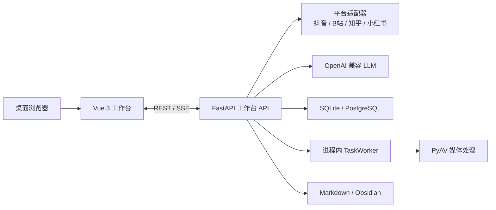

# 知记 Zhiji

把抖音、B 站、知乎、小红书等平台的知识视频 / 图文，以及本地资料，收拢到一套**自托管桌面知识工作台**：解析、成稿、笔记待办、检索问答、文档协作与媒体处理。

> **当前目标形态：桌面 Web 工作台。** v0.1.0 面向桌面浏览器与自托管单机，手机端和 SaaS 多租户不作为本版交付项。



## 功能特性

- **四平台视频解析**：抖音、B 站、知乎、小红书；粘贴链接后流式生成笔记，并支持继续追问与修改。
- **桌面工作台外壳**：Bento 首页、Dot Dock、Focus Mode 与统一会话抽屉；面向 1280×800 及以上桌面视口。
- **笔记与待办**：笔记 CRUD、标签、置顶、自动保存；待办优先级、截止日期、关联笔记与完成进度。
- **本地知识库**：资料导入、原文阅读、混合检索、引用片段与 SSE 资料问答。
- **文档助手**：单文档 CRUD、自动保存、笔记 / 知识库取材、SSE 总结问答续写润色与 Markdown 导出。
- **媒体工坊**：图片 / 音视频上传预览、搜索重命名、异步抽音轨 / 转码 / 裁剪、可选 Whisper 字幕与产物下载。
- **账号与隔离**：注册、登录、登出；会话、任务、笔记、知识库、文档和媒体均按用户隔离。
- **凭据安全**：LLM Key 与平台 Cookie 使用 AES-256-GCM 加密入库，界面只显示掩码。
- **自托管交付**：多阶段 Dockerfile、Docker Compose、健康检查、备份恢复与 Obsidian vault 接入。

## 项目文档

当前文档以工作台为唯一主轴：

| 文档 | 内容 |
| --- | --- |
| [产品定位](docs/WORKBENCH_PRODUCT.md) | 目标用户、工作区范围、边界与非目标 |
| [技术基线](docs/WORKBENCH_TECH.md) | 技术栈、模块边界、持久化、实时推送与验收基线 |
| [五个工具说明](docs/WORKBENCH_TOOLS.md) | 视频解析、笔记待办、知识库、文档助手、媒体工坊的原理与技术栈 |
| [数据 / API 现状](docs/WORKBENCH_DATA_API.md) | 已落地数据表与接口 |
| [前端改造计划](docs/WORKBENCH_FRONTEND_PLAN.md) | 设计方向、阶段进度与后续增强项 |
| [外部依赖](docs/WORKBENCH_DEPS.md) | 本机工具、在线服务与降级策略 |
| [部署指南](docs/DEPLOY.md) | Docker Compose、本机运行、备份恢复、PostgreSQL 与 Obsidian |
| [发布验收](docs/RELEASE_ACCEPTANCE.md) | v0.1.0 验收范围、结果、证据与复跑命令 |
| [演示指南](docs/DEMO.md) | 从启动到生成笔记的短演示流程 |

文档索引见 [docs/README.md](docs/README.md)。

## 快速开始

### Docker Compose（推荐）

```powershell
git clone <repo-url> zhiji
cd zhiji
Copy-Item .env.example .env
docker compose up -d
```

镜像构建阶段会自动执行前端 `npm ci` 与 `npm run build`，运行镜像直接托管 Vue 工作台。浏览器打开 **http://127.0.0.1:8000**，首次访问注册账号并配置模型。

默认只监听 `127.0.0.1`。局域网访问与公网注意事项见 [部署指南](docs/DEPLOY.md)。

### 本机开发

需要 Python 3.11+ 与 Node.js 18+。一键脚本会创建虚拟环境、安装依赖、构建 Vue 工作台、迁移数据库并启动服务：

```powershell
.\scripts\quickstart.bat
```

或手动运行：

```powershell
python -m venv .venv
.\.venv\Scripts\Activate.ps1
pip install -e ".[dev,asr]"
playwright install chromium
zhiji check-env

cd frontend
npm ci
npm run build
cd ..

zhiji web
```

冒烟测试需先启动服务：

```powershell
python scripts\smoke_test.py
```

## v0.1.0 发布验收

桌面 Web 发布候选验收已通过：

| 项目 | 结果 |
| --- | --- |
| Ruff / mypy / pytest | 通过；pytest 429 passed、1 skipped |
| 前端生产构建 | 通过 |
| API 冒烟 | 13/13 |
| 双账号隔离 | 47/47 |
| 重启持久化 | 26/26 |
| 备份恢复 | 26/26 |
| 桌面 UI | 65/65 |
| 打包不变量 | 14/14 |
| Docker 真构建 | 待 CI 的 docker job 执行 build / start / health |

完整范围、已知边界与复跑命令见 [docs/RELEASE_ACCEPTANCE.md](docs/RELEASE_ACCEPTANCE.md)。

## 项目结构

```text
frontend/                      # Vue 3 工作台
├── src/components/AppShell.vue
├── src/workspaces/            # 视频 / 笔记 / 知识库 / 文档 / 媒体
├── src/stores/
├── src/lib/
└── DESIGN.md

src/zhiji/
├── web/                       # FastAPI 入口与工作区 API
├── platforms/                 # 四平台适配器
├── llm/                       # OpenAI 兼容客户端
├── writer/                    # Markdown 幂等落盘
├── worker/                    # 进程内长任务执行
├── security/                  # 凭据加解密
├── storage/                   # ORM 表、仓储与用户作用域
├── knowledge.py               # 切片、检索与哈希向量
└── media_service.py           # PyAV 媒体处理

docs/                          # 当前工作台文档
scripts/                       # quickstart / smoke test
tests/                         # Python 测试与打包不变量
Dockerfile
docker-compose.yml
```

> `control-plane/` 是早期技术验证产物，不参与当前工作台运行链路，也不属于 v0.1.0 发布验收范围。

## 开发

```powershell
pytest
ruff check src tests
mypy

cd frontend
npm run build
npm run dev                    # Vite 开发服务 :5173
```

CI 在 Ubuntu / Windows × Python 3.11 / 3.12 上运行 Ruff、mypy 与 pytest，并包含独立前端构建、Docker 构建、非 root 启动和健康检查任务。

## 隐私与安全

- `data/`、`config/`、`output/`、`.env`、`.master_key` 与会话密钥不进入 Git。
- LLM Key 与平台 Cookie 只以密文入库，主密钥不进入数据库。
- 默认监听回环地址；公网开放必须自行补反向代理、HTTPS、限流和访问控制。

## 路线图

- [x] v0.1.0：桌面工作台、五个工作区 MVP、多用户隔离与自托管发布候选验收
- [ ] 笔记与待办：提醒、日历、习惯打卡、视频结果导入笔记
- [ ] 知识库：PDF / Office 解析、知记笔记自动入库
- [ ] 文档助手：批处理、复杂格式转换与异步文档任务
- [ ] 媒体工坊：批量处理、复杂滤镜与更多导出格式
- [ ] 第二版：再评估 SaaS 多租户、计费与运营能力

## 部署

完整部署、升级、备份恢复、PostgreSQL 切换与 Obsidian 接入说明见 [docs/DEPLOY.md](docs/DEPLOY.md)。
