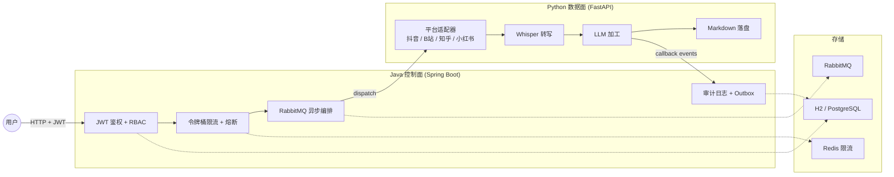

# 知记 Zhiji

把抖音、B 站、知乎、小红书等平台的知识视频 / 图文，以及本地资料，收拢到一套**自托管知识工作台**：解析、成稿、笔记待办、检索问答。

Java 控制面（Spring Boot）负责鉴权、配额、编排、审计；Python 数据面负责平台适配、转写、LLM 加工。一条 `docker compose up` 即可启动。



## 功能特性

- **四平台链路**：抖音（API + Playwright 音频拦截）、B 站（官方字幕优先 + Whisper 兜底 + WBI 签名搜索）、知乎（x-zse-96 签名 + 官方 API 全文）、小红书（图文 / 视频笔记解析）
- **Vue 工作台**：Bento 首页 + Dot Dock + 专注式工作区，桌面 / 移动响应式；FastAPI 托管 `frontend/dist/`
- **视频解析工作区**：粘贴链接 → 流式生成笔记 → 继续追问 / 修改；SSE 实时进度
- **笔记与待办**：笔记 CRUD、标签、置顶、自动保存；待办优先级、截止日期与关联笔记
- **本地知识库**：资料库 / 文本导入 / 原文阅读 / 混合检索 / 引用片段 / SSE 资料问答
- **异步任务闭环**：提交即返回 taskId，后台执行，可查询状态、取消、失败重试
- **多用户隔离**：注册 / 登录 / 登出，数据按用户严格隔离
- **凭据安全**：LLM Key 与平台 Cookie 全部 AES-256-GCM 加密入库，界面只显示掩码
- **Java 控制面**：Spring Security JWT 资源服务器、Redis 令牌桶限流、Resilience4j 熔断、RabbitMQ 异步编排（重试 / DLQ / 幂等）、Micrometer + Prometheus 指标、审计日志 + Outbox 事件
- **容器化部署**：多阶段 Dockerfile + Docker Compose 一键启动
- **Obsidian 接入**：笔记按 `zhiji_id` 幂等 upsert，输出目录可指向 vault

工作台的产品范围、技术实现和接口现状见 [docs/WORKBENCH_PRODUCT.md](docs/WORKBENCH_PRODUCT.md)、[docs/WORKBENCH_TECH.md](docs/WORKBENCH_TECH.md) 与 [docs/WORKBENCH_DATA_API.md](docs/WORKBENCH_DATA_API.md)。

## 快速开始

### Docker Compose（后端部署）

```powershell
git clone <repo-url> && cd zhiji
cp .env.example .env
docker compose up -d
# 浏览器打开 http://127.0.0.1:8000，首次访问注册账号
```

> 当前 Docker 镜像尚未内置 `frontend/` 的 Vue 构建产物，容器入口仍使用兼容静态页。要体验 Vue 工作台，请优先使用下方“本机开发”。

### 本机开发（推荐体验 Vue 工作台）

需要 Python 3.11+、Node.js 18+。一键脚本（首次运行自动创建 venv、安装依赖、迁移数据库；当前不含 Vue 构建）：

```powershell
.\scripts\quickstart.bat
```

或手动：

```powershell
python -m venv .venv
.\.venv\Scripts\Activate.ps1
pip install -e ".[dev,asr]"
playwright install chromium
zhiji check-env          # 验证环境
cd frontend
npm install
npm run build           # 生成 frontend/dist，供 FastAPI 托管
cd ..
zhiji web                # 启动 Web 服务 (http://127.0.0.1:8000)
```

冒烟测试：`python scripts\smoke_test.py`（需先启动服务）。演示流程见 [docs/DEMO.md](docs/DEMO.md)。

## 使用

### Web 方式

1. 左下角「设置 → 模型」添加一个 LLM 模型（名称 / API Key / Base URL / 模型 ID）
2. 「设置 → Cookie」按页面提示粘贴各平台 Cookie（B 站需含 `SESSDATA`，知乎需含 `d_c0`，抖音需含 `sessionid`，小红书需含 `web_session`）
3. 回到首页选择平台、粘贴链接，生成笔记后可继续对话修改
4. 进入「笔记与待办」管理本地笔记、标签和关联待办
5. 进入「知识库」新建资料库并导入 TXT / Markdown / CSV / JSON / HTML，随后可阅读、检索和基于资料问答

### CLI 方式

```powershell
zhiji note <链接>              # 生成笔记
zhiji search <关键词>          # 搜索（默认 bilibili）
zhiji douyin-login             # 浏览器登录并保存抖音登录态
zhiji models                   # 列出模型配置
zhiji config-show              # 查看当前设置
```

## 项目结构

```
src/zhiji/                     # Python 数据面
├── cli.py                     # CLI 入口 (typer)
├── pipeline.py                # 抓取 → 转写 → 生成 → 落盘 流水线
├── platforms/                 # 平台适配器 + Cookie 持久化
├── transcription/             # faster-whisper 转写引擎
├── writers/                   # Markdown 笔记落盘 (幂等 upsert)
├── llm/                       # OpenAI 兼容客户端 + 提示词
├── security/                  # AES-256-GCM 凭据加密
├── storage/                   # SQLAlchemy 数据层 (engine / tables / repository)
├── web/                       # FastAPI API + 兼容静态回退 (static/)
└── worker/                   # Java 控制面的 Python worker 模块

frontend/                      # Vue 3 工作台源码
├── src/components/           # 外壳、首页、Dock、设置等通用组件
├── src/workspaces/           # 视频 / 笔记待办 / 知识库工作区
├── src/stores/               # auth / core / ui 状态
├── src/lib/                  # API 与 Markdown 渲染
├── src/style.css             # 设计 token 与工作台样式
└── DESIGN.md                 # 视觉规范与验收记录

control-plane/                 # Java 控制面 (Spring Boot 3.3)
├── src/main/java/dev/zhiji/control/
│   ├── client/                # WorkerClient (熔断 + HTTP)
│   ├── config/                # Security / RabbitMQ / RateLimit / Scheduler
│   ├── controller/            # Auth / TaskDispatch / TaskCallback
│   ├── model/                 # User / TaskDispatch / AuditLog / OutboxEvent
│   ├── repository/            # JPA 仓储 (只增不改审计)
│   └── service/               # AuthService / TaskService / AuditService / OutboxPublisher
└── pom.xml

docs/                          # 架构文档、部署指南、计划书、ADR
├── ARCHITECTURE.md            # 架构设计（为什么这样设计）
├── DEPLOY.md                  # 部署指南（安装 / 升级 / 备份 / PostgreSQL / Obsidian）
├── PLAN.md                    # 落地计划书（具体怎么做、按什么顺序）
├── WORKBENCH_*.md             # 工作台产品 / 技术 / API / 前端计划 / 依赖现状
├── adr/                       # 架构决策记录 (ADR)
└── contracts/                 # 控制面 ↔ worker OpenAPI 契约
```

## 架构决策 (ADR)

关键决策记录在 [docs/adr/](docs/adr/)，摘要：

- **D1** 数据库用 SQLAlchemy，默认 SQLite，可切 PostgreSQL
- **D2** 异步先用任务表 + 进程内 worker，避免过早引入 MQ
- **D3** 认证先自研轻量，阶段 6 升级为 Spring Security JWT
- **D5** 凭据加密用 cryptography + 环境主密钥
- **D8** 自托管优先，不做对外开放注册的 SaaS
- **D9** Java 控制面按责任切分，不按接口重写
- **D12** Obsidian 接入取直接写 vault 目录，而非 REST API 插件

完整决策列表与背景 / 备选 / 推翻条件见 [docs/adr/README.md](docs/adr/README.md)。

## 部署

安装、升级、备份、PostgreSQL 切换、Obsidian vault 接入、公网部署等完整说明见 [docs/DEPLOY.md](docs/DEPLOY.md)。

默认只监听 `127.0.0.1`（只本机可访问）。要让局域网其他设备访问，把 `.env` 里 `ZHIJI_BIND` 改成 `0.0.0.0`，并理解这会暴露 API Key / Cookie 管理接口——公网开放请配合反向代理 + HTTPS。

## 开发

```powershell
pytest                          # Python 测试
ruff check src tests            # 代码检查
mypy                            # 类型检查
cd frontend; npm run build      # Vue 生产构建
cd frontend; npm run dev        # Vite 开发服务 (:5173)
cd control-plane; mvn test      # Java 测试
```

CI（GitHub Actions）在 Ubuntu 与 Windows 上跑 ruff、mypy、pytest 三件套 + Docker 构建。

## 隐私与安全

- `data/`（平台 Cookie）、`config/zhiji.json`（API Key）、`.env`、`.master_key` 均在 `.gitignore` 中
- Cookie 仅按平台白名单精简后加密入库
- 主密钥不入库、不进 Git

## 路线图

### 工作台改造

- [x] 阶段 A：Vue 3 + Vite + Pinia 框架迁移，① 视频解析迁入新外壳
- [x] 阶段 B：Bento 首页 + Dot Dock + Focus Mode + 会话抽屉
- [x] 阶段 C①：视频解析工作区与流式交互稳定
- [x] 阶段 C②（MVP）：笔记与待办 CRUD、自动保存、关联笔记
- [x] 阶段 C③（MVP）：知识库导入、阅读、检索、引用与资料问答
- [ ] 阶段 C②：提醒 / 日历 / 习惯打卡，视频解析结果导入笔记
- [ ] 阶段 C③：PDF / Office 解析，知记笔记自动入库
- [ ] 阶段 C④：文档助手
- [ ] 阶段 C⑤：媒体工坊
- [ ] 工程化收尾：Docker 镜像内置 Vue 构建产物

### 平台能力

- [x] 四平台链路 + Web 工作台
- [x] 数据库持久化 (SQLAlchemy + SQLite/PostgreSQL)
- [x] 异步任务闭环 (状态机 + 后台执行 + SSE)
- [x] 多用户账号与数据隔离
- [x] 凭据安全 (AES-256-GCM 加密入库)
- [x] 容器化部署 (Docker Compose)
- [x] Obsidian vault 接入 (幂等 upsert)
- [x] Java 控制面 (JWT 鉴权 + 限流熔断 + RabbitMQ 编排 + 审计)
- [x] 作品集交付收尾 (README / 图示 / ADR / 演示脚本)
- [ ] 本地一体化应用，桌面端前身 (阶段 8：Java 托管前端+API / Python 退化为纯 worker / 生产中间件 / 一键启动打包)