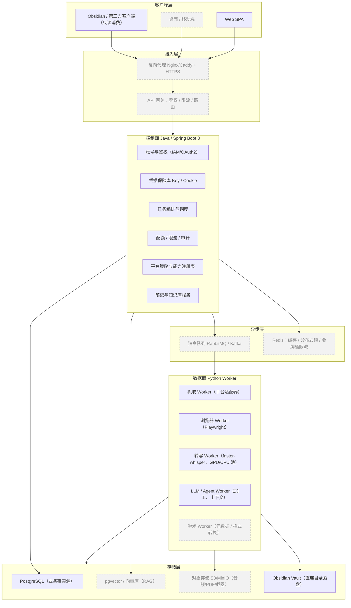

# 知记（Zhiji）落地架构设计文档

> 版本：v1.1 　编制日期：2026-10-09 　修订：2026-10-13 　代码基线：本地 `main`（阶段 0–4 全部完成）
> 文档性质：**架构设计 / 可行性评估**，不含实现代码。
> 与 `docs/PLAN.md` 的分工：本文画**目标形态**（能长成什么样），`PLAN.md` 定**实施顺序**（先做什么）；
> 二者口径以 `PLAN.md` 的阶段 0–7 为准。§5.1 用**实线框 / 灰底虚线框**区分「自托管形态已需要」与「产品化 / 多机形态才需要」。

---

## 1. 文档目的与范围

本文回答三个问题：

1. 现有项目要"落地成产品"，用户提出的 5 个方向是否可行、代价多大、有哪些坑；
2. 业界（GitHub）有哪些可直接复用或借鉴的项目；
3. 如果按"传统后端技术栈 + Agent 能力"的思路重构，目标架构应该长什么样。

**范围**：架构层面的可行性、选型与演进路线。**不含**：具体代码实现、接口详细字段定义、排期工时。

---

## 2. 现状评估

### 2.1 当前形态

知记目前是一个**单体 Python 应用**，进程内同时提供 CLI 与 Web 两个入口，核心链路为：

```
输入（URL / 关键词）
  → 平台适配器抓取（抖音 / B 站 / 知乎 / 小红书）
  → 可选语音转写（faster-whisper）
  → LLM 加工（摘要 / 结构化 / 拆解）
  → Markdown 输出
  → （手工）粘贴进 Obsidian 等知识库
```

### 2.2 代码规模（按行数）

| 模块 | 文件 | 行数 | 说明 |
| --- | --- | --- | --- |
| 应用层 | `chat.py` | 201 | 对话式交互 |
| | `cli.py` | 262 | Typer 命令行入口 |
| | `pipeline.py` | 229 | 抓取→转写→加工→写出的编排 |
| | `config.py` / `models.py` | — | 配置门面与数据模型；配置默认入库（阶段 1.3） |
| | `errors.py` / `tmpfiles.py` | 46 / 34 | 错误与临时文件 |
| Web | `web/app.py` | 515 | FastAPI 应用（含内嵌静态页） |
| | `web/static/*` | — | config.html / app.css / app.js |
| 平台适配 | `platforms/douyin.py` | 269 | 抖音 |
| | `platforms/bilibili.py` + `bilibili_wbi.py` | 251 + 38 | B 站（含 WBI 签名） |
| | `platforms/zhihu.py` | 417 | 知乎 |
| | `platforms/xiaohongshu.py` | 322 | 小红书（Playwright） |
| | `platforms/zse.py` | 550 | ZSE v4 签名 |
| | `platforms/*_cookies.py` / `cookies.py` | ~340 | 各平台 Cookie / profile |
| | `platforms/registry.py` / `base.py` | 36 / 20 | 适配器注册与基类 |
| LLM | `llm/client.py` + `prompts.py` | 138 + 126 | OpenAI 兼容客户端与提示词 |
| 转写 | `transcription/engine.py` | 80 | faster-whisper 封装 |
| 写出 | `writers/markdown.py` | 84 | Markdown 生成 |

**依赖**：Typer / Rich / Pydantic / FastAPI / Uvicorn / httpx / Playwright / python-dotenv / PyYAML / yt-dlp / curl-cffi / html2text；可选 `asr` = faster-whisper；开发 `dev` = pytest / pytest-asyncio / ruff / mypy。

**质量基线（2026-10-13）**：测试 366 通过 / 1 跳过，ruff 全绿，mypy 47 文件无告警。

### 2.3 能力矩阵：现状 vs 落地差距

| 维度 | 现状 | 落地所需 | 差距等级 |
| --- | --- | --- | --- |
| 抓取 | 4 平台适配器，进程内调用 | 插件化、可扩展、可灰度 | 中 |
| 转写 | 本地 faster-whisper，同步阻塞 | 异步任务、GPU/CPU 池、可伸缩 | 中 |
| LLM | 多模型配置，同步调用 | 路由、降级、配额、成本统计 | 中 |
| 数据持久化 | **无数据库**，产物落 Markdown 文件 | 业务库 + 对象存储 | **高** |
| 账号 | **无**，无登录/多用户 | IAM、多租户隔离 | **高** |
| 密钥/凭据 | Cookie 明文 JSON（`data/*-profile.json`） | 加密、隔离、轮换、审计 | **高** |
| 并发 | 无队列，同步串行 | MQ + worker 池 + 限流 | **高** |
| 部署 | 本机 `start.bat` | 容器化 + 编排 + 可观测 | **高** |
| 知识库 | 手工粘贴 | Obsidian 自动同步 | 中 |
| 合规模块 | 无 | 平台 ToS / 版权策略 | **高** |

**结论**：代码层（适配器、pipeline、LLM 封装）质量不错、可复用；**缺的是"系统层"**——持久化、身份、并发、部署、合规。落地的主要工作量在系统层，而不是重写抓取逻辑。

---

## 3. 五点方向可行性分析

### 3.1 数据库 / 连接 Obsidian

**结论：可行，但要把"存数据库"与"连 Obsidian"当成两件独立的事，不要混为一谈。**

概念澄清：

- **Obsidian 没有数据库**。一个 vault 就是磁盘上的一堆 Markdown 文件（外加 `.obsidian/` 配置）。它既是编辑器，也是文件格式。
- 因此"数据库"指的是**你自己系统的业务库**（元数据、任务、用户、凭据）；"连接 Obsidian"指的是**产物落地到知识库**的方式。

Obsidian 接入的三种方式：

| 方式 | 原理 | 优点 | 缺点 | 适用 |
| --- | --- | --- | --- | --- |
| A. 直接写 vault 目录 | 服务端直接落到用户 vault 路径 | 零依赖、最快 | 要求服务能访问用户磁盘 → **跨机部署直接不可行**；并发写有冲突风险 | 单机自用 |
| B. Obsidian Local REST API 插件 | 装插件，应用通过 HTTP 调用 | 官方生态、跨机可用、支持读写与搜索 | 需要用户装插件、开本地端口 | **推荐** |
| C. MCP（mcp-obsidian 等） | 通过 MCP 协议暴露给 Agent | 与 Agent 场景天然契合 | 依赖 Agent 框架、调试链路长 | Agent 增强 |

**推荐架构**：

- **PostgreSQL** 作为系统事实来源（Source of Truth）：笔记元数据、任务状态、用户、凭据索引、成本账本。
- **Obsidian 作为"输出目标 / 知识库前端"**：通过 `obsidian-local-rest-api` 写入，或退化为"导出 Markdown 文件夹让用户自行同步"。
- 关键点：**系统永远不假设 vault 可被自己直接读写**；能直连是优化，连不上是常态。
- 可选增强：在 PostgreSQL 上挂 `pgvector` 做语义检索，为"上下文管理 / RAG"服务。

**风险**：Obsidian 插件方案依赖用户环境；vault 文件冲突需幂等写入（用笔记 ID / front-matter 标识做 upsert）。

> **v1.1 增补**：上表是**三种方式的通用对比**。按 `PLAN.md` D12，**自托管形态采用 A（直接写 vault 目录）**，理由是：本项目的产物本身就是带 YAML front-matter 的纯 Markdown、`output_dir` 已是配置项、单机部署下「服务能访问用户磁盘」天然成立；B（Local REST API 插件）降级为**跨机 / 云端形态**的候选（`PLAN.md` 5.5.4）。选择 A 的代价是必须保证**幂等写入**（见 `PLAN.md` 5.5.2）。

---

### 3.2 加入其他平台（含论文网站 / 知网）

**结论：多平台扩展在工程上可行且边际成本低；但知网这类学术站点存在明确的合规红线，需要把"能抓"和"该抓"分开。**

分两类处理：

**① 社交/内容平台（抖音、B 站、知乎、小红书、快手、微博……）**

- 已有统一适配器模式（`base.py` + `registry.py`），新增平台 ≈ 新增一个 adapter + 一套 Cookie/签名逻辑。
- 工程难点不在"写适配器"，而在**反爬对抗、登录态维持、风控**。这些不应散落在业务代码里，应下沉为独立能力（浏览器集群 + 凭据池 + 代理池）。
- 不建议自研全部平台：优先"自研核心 2~3 个 + 第三方 API 兜底"。

**② 学术平台（知网 CNKI、万方、维普、Google Scholar、arXiv……）**

⚠️ **必须显式提示的合规风险**：知网有严格的版权与访问条款，**批量抓取 / 下载全文**可能违反服务条款甚至触及著作权法。技术可行 ≠ 允许。

推荐做法（由轻到重）：

1. **元数据优先**：只抓标题/作者/摘要/DOI/关键词等元数据（可参考 Zotero translator、jasminum）；全文由用户本人通过其机构订阅获取。
2. **用户自备文件**：用户上传自己合法获得的 PDF/CAJ，系统只做**格式转换**与**解析**（caj2pdf）。
3. **不强求登录态复用**：不要把机构账号凭据接入系统。
4. arXiv / PubMed / Crossref / OpenAlex 等**开放 API** 可放心接入，且是学术场景性价比最高的部分。

**架构要求**：适配器插件化 + **平台能力声明**（是否需要登录、是否允许批量、QPS 上限、合规等级），让平台策略成为配置而非硬编码。

---

### 3.3 服务器部署，客户端 / 服务端

**结论：可行。当前已有 FastAPI Web 形态，把它从"本地脚本"升级为"标准 C/S 系统"是常规工程。**

拆分方式：

```
客户端（Web SPA / 桌面 / 移动端）
      ↓ HTTPS
反向代理（Nginx / Caddy）
      ↓
API 服务（Java/Spring Boot：鉴权、业务、编排）
      ↓
异步任务（消息队列）
      ↓
Worker 集群（Python：抓取 / 转写 / LLM 加工）
      ↓
存储（PostgreSQL / Redis / 对象存储 / 向量库）
```

**部署演进三阶段**：

| 阶段 | 形态 | 适用 | 要点 |
| --- | --- | --- | --- |
| 单机 | Docker Compose | 自用 / 早期 | 一键起全栈，含 DB/Redis/MQ |
| 小规模 | 多机 / Compose + 反代 | 小团队 | API 与 Worker 分离部署，横向扩 Worker |
| 规模化 | Kubernetes | 产品化 | HPA 按队列深度伸缩，独立存储与命名空间隔离 |

必须补齐的"部署配套"：反向代理与 HTTPS、健康检查（liveness/readiness）、配置中心、日志聚合（Loki/ELK）、指标监控（Prometheus + Grafana）、链路追踪（OpenTelemetry）、备份与灾恢。

**注意**：抓取/浏览器类 Worker 对"有头浏览器 + 图形环境"有依赖，容器内建议用无头浏览器服务（browserless）而非在业务容器里跑 Playwright。

---

### 3.4 账号管理 / Key 管理 / Cookie 管理 / 上下文管理 / 高并发

这是**整个落地里最难、也最决定产品形态的一块**。逐个拆解。

#### 3.4.1 账号管理

- 需要：注册/登录、会话与 JWT、RBAC、多租户（用户级数据隔离）、审计日志。
- 两个路线：
  - **自研**：Spring Security + JWT + PostgreSQL，可控但要处理大量安全细节。
  - **引入 IAM**：Casdoor（开源 IAM，含 OAuth/OIDC、多租户、MCP 网关）可显著降低前期成本。
- 建议：**早期引入成熟 IAM，把精力留给核心业务**。

#### 3.4.2 Key 管理（LLM/API Key）

- 绝不明文落库、绝不回显完整 Key（只回显尾号）。
- 存储：**信封加密**（KMS/Vault 主密钥 + 数据密钥 AES-GCM），或直接用 Vault/KMS 托管。
- 功能：按用户/按模型隔离、限流配额、成本统计、到期与轮换、审计（谁在何时用了哪把 Key）。
- 现状差距：当前模型配置写在 `config/zhiji.json`，属于"单机本地明文"，必须改造。

#### 3.4.3 Cookie / 登录态管理（**最高风险项**）

- 现状：`data/*-profile.json` 明文存储，无隔离、无过期检测、无轮换。
- 目标能力：
  - **加密存储**：与 Key 同级的信封加密，按用户 + 平台隔离。
  - **生命周期**：采集 → 校验 → 使用 → 过期检测 → 失效告警 → 重新采集。
  - **健康巡检**：定时（如每 6h）轻量探测，标记 `valid / expiring / invalid`。
  - **浏览器上下文池**：用 browserless/浏览器集群承载，避免每个任务都冷启动浏览器。
  - **合规提醒**：Cookie 属于用户凭据，涉及隐私与平台条款，需要用户授权与告知。
- 说明：小红书适配器的 headless 启动在本机已知不可用（需 `channel=chrome/chromium`），这类环境差异应当由"浏览器服务"统一吸收，而不是在每个 adapter 里打补丁。

#### 3.4.4 上下文管理

- 三个层次：
  1. **会话上下文**：一次对话/任务的中间态（抓取结果、转写文本、LLM 调用链）。
  2. **用户上下文**：偏好、常用平台、输出模板、历史笔记。
  3. **知识上下文（RAG）**：对历史笔记/文档做向量化，检索后注入提示词。
- 存储：会话态放 Redis（带 TTL），长期态放 PostgreSQL，向量放 pgvector / 专用向量库。
- 关键：上下文要有**预算控制**（token 上限、裁剪策略），否则成本失控。

#### 3.4.5 高并发管理

- 先分类任务，再谈并发：
  - **IO 密集**（抓取、LLM 调用）：靠"并发 + 限流"，受制于平台 QPS，**不是越多越好**。
  - **CPU/GPU 密集**（语音转写）：靠"worker 池 + 队列深度"，需要独立资源池与背压。
- 必备机制：
  - 异步队列（RabbitMQ / Kafka / Redis Stream）解耦请求与执行；
  - **平台级分布式限流**（Redis 令牌桶），每平台独立 QPS 与并发上限；
  - 优先级队列 + 重试（指数退避）+ 死信队列；
  - 熔断与降级（平台不可用时降级到第三方 API 或排队）；
  - 任务幂等（同一 URL 去重，基于内容指纹）；
  - 可观测：队列深度、任务时延、失败率、平台封禁率。
- **现实提醒**：抓取规模的瓶颈几乎永远是**平台风控**，而非你的服务器。架构要假设"随时被限流"，并为此设计隔离（账号/代理/浏览器指纹池）。

---

### 3.5 整体用 Java，Agent 部分用 Python？

**结论：可行，而且对"想积累传统后端技术栈经验"的目标来说，这是很合适的选型。推荐"Java 控制面 + Python 数据面"的混合架构。**

三种方案对比：

| 方案 | 优点 | 缺点 | 适配度 |
| --- | --- | --- | --- |
| 全 Python | 现有代码可直接演进，生态最顺（Playwright/ASR/LLM 全是 Python） | 传统后端能力（事务、IAM 生态、企业集成）偏弱；用户想练 Java 的目标落空 | 快，但不满足诉求 |
| 全 Java | 技术栈统一、后端能力强、部署简单 | **Agent/爬虫/ASR 生态明显弱于 Python**；Playwright、faster-whisper、大量平台库都要重写或走外挂 | 不现实 |
| **Java + Python 混合** | Java 承担它最擅长的"控制面"，Python 承担它最擅长的"数据面"；现有平台适配器**几乎可原样保留** | 引入跨语言契约与两套运行时，运维复杂度上升 | **推荐** |

分工建议：

| 层 | 语言 | 职责 |
| --- | --- | --- |
| 控制面（Control Plane） | **Java / Spring Boot 3** | 账号与鉴权、Key/Cookie 保险库、任务编排与调度、配额计费、API 网关、审计、平台策略 |
| 数据面（Data Plane） | **Python** | 平台抓取适配器、Playwright 浏览器自动化、语音转写、LLM/Agent 加工、向量化 |

解耦方式：

- **契约优先**：控制面与 worker 之间用 HTTP（OpenAPI）定义任务提交/回调；用消息队列（RabbitMQ/Kafka）传递任务与结果。
- **不要 RPC 强耦合**：避免让 Java 直接调用 Python 函数，改为"提交任务 → 异步执行 → 回调/事件"。
- **序列化契约**：统一用 JSON（或 Protobuf/Avro），显式版本号，双向兼容。
- **可观测**：统一 trace-id 贯穿 Java 与 Python，否则跨语言排障会非常痛苦。

风险与代价（必须承认）：

- 两套技术栈 = 两套依赖管理、两套 CI、两套监控；小团队维护成本明显上升；
- 跨语言调试与事务边界更难；
- 需要一位懂双方的"契约守门人"。

**结论**：如果目标是"传统后端技术栈 + Agent 能力"的作品集/产品，Java + Python 是最有说服力的组合；如果只是自己用，纯 Python 更省事。**建议分阶段**：先补 API 层与持久化（可在 Python 内完成），待系统层稳定后再把控制面迁到 Java，避免一次性重写。
---

## 4. GitHub 参考项目（star 数为 2026-10 核查值）

### 4.1 Obsidian / 知识库集成

| 项目 | Star | 语言 | 用途 | 建议 |
| --- | --- | --- | --- | --- |
| [coddingtonbear/obsidian-local-rest-api](https://github.com/coddingtonbear/obsidian-local-rest-api) | ★3010 | TypeScript | Obsidian 本地 REST API + MCP | **首选**：笔记写入/读取标准通道 |
| [MarkusPfundstein/mcp-obsidian](https://github.com/MarkusPfundstein/mcp-obsidian) | ★4467 | Python | 经 REST API 访问 Obsidian 的 MCP server | Agent 场景接入 |
| [bitbonsai/mcpvault](https://github.com/bitbonsai/mcpvault) | ★1682 | TypeScript | Obsidian vault 的 MCP | 备选 |
| [PublikPrinciple/obsidian-mcp-rest](https://github.com/PublikPrinciple/obsidian-mcp-rest) | ★69 | — | Obsidian MCP（REST） | 备选 |
| [haixiong1997/Bilibili-Obsidian-Clipper](https://github.com/haixiong1997/Bilibili-Obsidian-Clipper) | ★585 | Python | B 站字幕 → Obsidian | **场景高度重合**，可直接借鉴 |
| [siyuan-note/siyuan](https://github.com/siyuan-note/siyuan) | ★46693 | TypeScript | 自托管知识工作台（Obsidian 替代品） | 若考虑自研知识端可参考 |

### 4.2 学术 / 知网相关

| 项目 | Star | 语言 | 用途 | 合规提示 |
| --- | --- | --- | --- | --- |
| [l0o0/jasminum](https://github.com/l0o0/jasminum) | ★7280 | TypeScript | Zotero 插件，抓取 CNKI 元数据 | ✅ 元数据路线，推荐 |
| [l0o0/translators_CN](https://github.com/l0o0/translators_CN) | ★4765 | JS | Zotero 中文站点 translator | ✅ 元数据路线，推荐 |
| [caj2pdf/caj2pdf](https://github.com/caj2pdf/caj2pdf) | ★3244 | Python | CAJ → PDF 转换 | ✅ 仅做格式转换，用户自备文件 |
| [bughandler/cnki-downloader](https://github.com/bughandler/cnki-downloader) | ★1767 | Python | 知网下载工具 | ⚠️ **不建议**，版权/ToS 风险 |

### 4.3 多平台抓取（工程参考）

| 项目 | Star | 语言 | 覆盖 | 建议 |
| --- | --- | --- | --- | --- |
| [NanmiCoder/MediaCrawler](https://github.com/NanmiCoder/MediaCrawler) | ★66497 | Python | 小红书/抖音/快手/B 站/微博/贴吧/知乎 | **最值得参考**：平台适配与登录态处理 |
| [Nemo2011/bilibili-api](https://github.com/Nemo2011/bilibili-api) | ★4170 | Python | B 站 | 可替换自研 B 站逻辑 |
| [3441293738/creatorhub](https://github.com/3441293738/creatorhub) | ★2237 | — | 多平台创作者工具 | 参考 |
| [lixi5338619/lxSpider](https://github.com/lixi5338619/lxSpider) | ★1976 | Python | 多平台 | 参考 |
| [TikHub/TikHub-API-Python-SDK](https://github.com/TikHub/TikHub-API-Python-SDK) | ★907 | Python | 抖音/TikTok/小红书/快手/微博/IG 等 | **商业 API 兜底**，规避风控 |
| [cv-cat/catbus](https://github.com/cv-cat/catbus) | ★249 | TypeScript | 小红书/抖音/TikTok/B 站/快手/微博/闲鱼/淘宝/京东/X | 统一命令 + JSON 输出，Agent 友好 |

### 4.4 Java 技术栈（控制面选型）

| 项目 | Star | 用途 | 建议 |
| --- | --- | --- | --- |
| [spring-projects/spring-ai](https://github.com/spring-projects/spring-ai) | ★9522 | Spring 官方 AI 抽象（模型/向量库/RAG/工具调用） | **核心**：Java 侧 LLM 与向量能力 |
| [langchain4j/langchain4j](https://github.com/langchain4j/langchain4j) | ★13219 | JVM 上的 LLM 应用框架 | 与 Spring AI 二选一或互补 |
| [Atmosphere/atmosphere](https://github.com/Atmosphere/atmosphere) | ★3818 | JVM 可移植 Agent Runtime（可跑在 Spring AI / LangChain4j 之上） | Agent 编排可选 |
| [liyupi/yu-ai-agent](https://github.com/liyupi/yu-ai-agent) | ★2724 | Spring Boot 3 + Java 21 + Spring AI 实战 | **学习/骨架参考** |
| [YunaiV/ruoyi-vue-pro](https://github.com/YunaiV/ruoyi-vue-pro) | ★39604 | 企业级后台脚手架（RBAC/多租户/工作流） | **后台脚手架参考** |
| [jeecgboot/JeecgBoot](https://github.com/jeecgboot/JeecgBoot) | ★48119 | 低代码企业脚手架 | 备选脚手架 |

### 4.5 浏览器集群 / 高并发

| 项目 | Star | 语言 | 用途 | 建议 |
| --- | --- | --- | --- | --- |
| [browserless/browserless](https://github.com/browserless/browserless) | ★13793 | TypeScript | Docker 化无头浏览器服务 | **首选**：统一浏览器能力，吸收环境差异 |
| [934050259/BrowserCluster](https://github.com/934050259/BrowserCluster) | ★280 | Python | Playwright + DrissionPage + FastAPI 集群 | 备选 |
| [alcounit/selenosis](https://github.com/alcounit/selenosis) | ★93 | — | K8s 上可伸缩的 Selenium/Playwright Hub | K8s 阶段参考 |

### 4.6 身份 / 账号 / 凭据

| 项目 | Star | 语言 | 用途 | 建议 |
| --- | --- | --- | --- | --- |
| [casdoor/casdoor](https://github.com/casdoor/casdoor) | ★14530 | Go | 开源 IAM（OAuth/OIDC、多租户、MCP 网关） | **首选**：账号体系开箱即用 |

### 4.7 Agent 编排平台（可参考或直接复用）

| 项目 | Star | 语言 | 用途 |
| --- | --- | --- | --- |
| [langgenius/dify](https://github.com/langgenius/dify) | ★157978 | TypeScript | LLM 应用/Agent 编排平台 |
| [langbot-app/LangBot](https://github.com/langbot-app/LangBot) | ★18060 | Python | 多平台 LLM 机器人 |

---

## 5. 目标架构

### 5.1 总体分层



**图例（v1.1 增补）**

- **实线框**：自托管形态**已经需要**的组件。
- **灰底虚线框**（`C2` 桌面 / 移动端、`G1` 反向代理、`G2` API 网关、`Q1` 消息队列、`Q2` Redis、`W5` 学术 Worker、`D2` 向量库、`D3` 对象存储）：**阶段 6+ / 产品化阶段**才有意义。其中 `C2`、`W5`、`D3` 已在 `PLAN.md` §1.3 列为**非目标**；`G1` / `G2` / `Q1` / `Q2` / `D2` 属「**保留但未排期**」（见 `PLAN.md` §1.5）。
- **分层结构本身不变**：客户端 / 接入 / 控制面 / 异步 / 数据面 / 存储这六层，在自托管形态下**同样成立**——阶段 1–4 的「控制面」就是 Python 单体应用自身，阶段 6 只是把这一层的**实现**换成 Java，而不是新增一层。所以**总体分层没有变化，变的是每层的实现密度与组件数量**。

**设计要点**：

1. **控制面与数据面分离**：控制面只管「该做什么、允不允许、算不算超配额」，数据面只管「把活干出来」。两侧可独立伸缩、独立发布。
   - *自托管形态*：控制面就是**已有的 Python 单体**（FastAPI + 业务逻辑 + 任务表），不必先拆 Java；阶段 6 再把这一层替换为 Spring Boot，**契约不变**。
2. **异步优先**：抓取 / 转写都是长任务，一律「提交任务 → 返回 taskId → 轮询或推送结果」，不做同步阻塞。
   - *自托管形态*：阶段 3 起用**库内任务表 + 后台执行体**实现同一语义；MQ（Q1 / Q2）是阶段 6 的线性升级，**不是前置条件**。
3. **浏览器能力外置**：多 Worker / 多机时，所有 Playwright 需求走 browserless 或浏览器集群，避免把浏览器运行时塞进业务容器。
   - *自托管形态*：单机阶段浏览器**直接内嵌在应用镜像内**（Playwright 依赖随镜像分发）；browserless 只在需要横向扩 Worker 时才有收益。
4. **存储分层**：结构化 → PostgreSQL；缓存 / 锁 / 限流 → Redis；大文件 → 对象存储；语义检索 → 向量库；知识产物 → Obsidian。
   - *自托管形态*：结构化 → **SQLite**（阶段 1.3 已落地）；大文件 → **Docker 具名卷**（不引入 MinIO）；知识产物 → **直连 Obsidian vault 目录**（`PLAN.md` 5.5）；Redis / 向量库 / 对象存储均**不进当前阶段**。
5. **策略即配置**：平台 QPS、是否需登录、合规等级、限流阈值都写入「平台注册表」，而非散落代码。
   - *自托管形态*：这一条**已经成立**（平台能力注册表已在代码中），后续只是补齐策略项。

### 5.2 技术选型

| 层次 | 选型 | 备选 | 理由 |
| --- | --- | --- | --- |
| 客户端 | React/Vue SPA | 现有静态页 | 现有 `web/static` 可先保留，后续替换 |
| 反向代理 | Nginx / Caddy | Traefik | HTTPS 自动化、静态托管 |
| API 网关 | Spring Cloud Gateway | Kong | Java 生态一致 |
| 控制面框架 | Spring Boot 3 + Java 21 | Quarkus | 生态成熟、招人容易 |
| 身份 | Casdoor（OIDC） | 自研 Spring Security | 降低安全实现成本 |
| AI 抽象（Java） | Spring AI | LangChain4j | 官方、与 Spring 集成好 |
| 消息队列 | RabbitMQ | Kafka / Redis Stream | 任务语义清晰、运维简单；Kafka 用于高吞吐 |
| 缓存/限流 | Redis | — | 分布式锁 + 令牌桶必备 |
| 业务库 | PostgreSQL 16 | MySQL | JSONB、事务、pgvector 一体 |
| 向量库 | pgvector | Milvus / Qdrant | 早期免额外组件，够用 |
| 对象存储 | MinIO（S3 兼容） | 云对象存储 | 自托管友好 |
| 抓取/Agent | **Python 3.11+**（复用现有代码） | — | Playwright / ASR / 平台库生态最强 |
| 浏览器 | browserless | 自建 Playwright 集群 | 统一环境、可伸缩 |
| ASR | faster-whisper | Whisper API | 已有实现，本地可控 |
| 可观测 | Prometheus + Grafana + Loki + OpenTelemetry | ELK | 指标/日志/链路三件套 |
| 部署 | Docker Compose → K8s | — | 分阶段，避免过早复杂 |
| CI/CD | GitHub Actions | GitLab CI | 现有仓库在 GitHub |

**阶段归属（v1.1 增补）**：上表是**目标形态的全量选型**，不等于当前阶段清单。对照 `PLAN.md`：

- **阶段 1–5 实际需要**：Python 3.11+、FastAPI / Uvicorn、Pydantic、SQLite、Docker（Compose + 具名卷）、ruff / mypy / pytest、GitHub Actions。
- **阶段 6 才需要**（「保留但未排期」，见 `PLAN.md` §1.5）：反向代理、API 网关、RabbitMQ / Kafka、Redis、PostgreSQL、pgvector、MinIO、browserless。
- **非目标**：Kubernetes、对外 SaaS 计费、对象存储服务、学术全文抓取。
- **身份选型降级**：Casdoor 由「首选」调整为「**仅在需要对外开放注册时才考虑**」；自托管多用户用本地账号 + 会话即可（`PLAN.md` D8）。

### 5.3 模块划分与职责

**控制面（Java，新增）**

| 模块 | 职责 | 关键点 |
| --- | --- | --- |
| `auth-service` | 注册/登录、OAuth2/OIDC、JWT、RBAC、多租户 | 与 Casdoor 对接，租户 ID 贯穿全链路 |
| `vault-service` | LLM Key / 平台 Cookie 的加密存储与轮换 | 信封加密、只回显尾号、全量审计 |
| `task-service` | 任务创建、状态机、优先级、重试、幂等 | 状态机：PENDING→RUNNING→SUCCEEDED/FAILED/DEAD |
| `orchestrator` | 编排 pipeline（抓取→转写→加工→落地） | 步骤可插拔，支持 DAG |
| `platform-registry` | 平台元数据与策略（QPS、是否需登录、合规等级） | 配置化，支持灰度与开关 |
| `quota-billing` | 配额、用量、成本账本 | 按用户/模型/平台维度统计 |
| `note-service` | 笔记元数据、版本、标签、与 Obsidian 映射 | upsert 幂等，front-matter 带系统 ID |
| `audit-service` | 操作审计与合规留痕 | 不可篡改、可导出 |

> **控制面表格说明（v1.1 增补）**：上表是**阶段 6 的目标模块划分**。自托管形态下这些职责**已由现有 Python 控制面兼任**（账号、凭据保险库、任务编排、审计均已落地或已排期）；阶段 6 只做**实现替换（Python → Spring Boot）**，不改变模块边界（`PLAN.md` D9）。其中 `quota-billing` 的**计费**部分与 `note-service` 的**多租户**部分属非目标；`auth-service` 在自托管形态下不依赖 Casdoor。

**数据面（Python，复用现有 + 扩展）**

| 模块 | 来源 | 改造点 |
| --- | --- | --- |
| `platforms/` | **现有代码** | 保持适配器接口，改为"拉任务 → 执行 → 回调" |
| `transcription/` | **现有代码** | 抽成独立 worker，支持队列消费与资源池 |
| `llm/` | **现有代码** | Key 改由 Vault 下发，增加路由/降级/成本回传 |
| `writers/` | **现有代码** | 稳定 ID + 幂等 upsert；**直连 vault 目录**（`PLAN.md` 5.5）；REST 后端留待跨机（5.5.4） |
| `agent/` | 新增 | 多步任务编排（检索→加工→校验） |
| `academic/` | 新增 | 元数据抓取 + CAJ 转换（合规路线）——**非目标**，见 `PLAN.md` §1.3 |
| `worker-runtime` | 新增 | 统一消费队列、上报心跳、优雅退出、trace 透传 |

**关键：现有 `platforms/` 与 `pipeline.py` 的接口设计良好，是本次架构迁移中价值最高的可复用资产。**
### 5.4 核心数据模型

| 表 / 实体 | 关键字段 | 说明 |
| --- | --- | --- |
| `tenant` | id, name, plan, created_at | 多租户根实体 |
| `user` | id, tenant_id, email, password_hash, status | 账号主体（或由 IAM 托管，本地仅存映射） |
| `role` / `user_role` | user_id, role, scope | RBAC |
| `llm_credential` | id, user_id, provider, key_cipher, key_hint, status, expires_at | LLM Key，**密文存储**，`key_hint` 仅尾号 |
| `platform_credential` | id, user_id, platform, cookie_cipher, fingerprint, health, checked_at, expires_at | 平台登录态，**密文存储** + 健康状态 |
| `platform` | code, name, needs_login, qps_limit, compliance_level, enabled | 平台注册表（策略驱动） |
| `task` | id, user_id, type, platform, input, status, priority, idempotency_key, trace_id, created_at, finished_at | 任务主表；`idempotency_key` 保证幂等 |
| `task_step` | id, task_id, seq, name, status, attempt, error, started_at, finished_at | pipeline 步骤明细（抓取/转写/加工/写出） |
| `note` | id, user_id, source_url, content_hash, title, tags, version, created_at | 笔记元数据（正文可落对象存储 / Obsidian） |
| `note_export` | id, note_id, target, external_id, status, exported_at | 与 Obsidian 等外部目标的映射（upsert 依据） |
| `usage_ledger` | id, user_id, task_id, model, tokens_in, tokens_out, cost, created_at | 计费/成本账本 |
| `audit_log` | id, user_id, action, resource, detail, ip, created_at | 审计留痕，只增不改 |
| `note_embedding` | note_id, chunk_id, embedding(vector) | pgvector，用于 RAG |

设计原则：所有业务表带 `tenant_id`/`user_id`（隔离）；`task`/`task_step` 有完整状态机；凭据一律密文列，明文永不出库。

> **表结构说明（v1.1 增补）**：上表是**目标形态全量表**。自托管形态下 `tenant` / `usage_ledger` / `note_embedding` **不建**（无多租户、无计费、无 RAG）；平台登录态实际以**整份 `payload_cipher`** 存储（字段名不是 `cookie_cipher`）。**实际表结构以 `src/zhiji/storage/tables.py` 为准。**

### 5.5 接口契约

**对外 REST（控制面提供）**

| 方法 | 路径 | 说明 |
| --- | --- | --- |
| `POST` | `/api/v1/tasks` | 提交任务（含 `type`、`platform`、`input`、`idempotency_key`），返回 `taskId` |
| `GET` | `/api/v1/tasks/{id}` | 查询任务与步骤状态 |
| `GET` | `/api/v1/tasks` | 分页列表（按用户/状态/平台过滤） |
| `POST` | `/api/v1/tasks/{id}/cancel` | 取消任务 |
| `GET` | `/api/v1/platforms` | 平台能力与策略列表 |
| `PUT` | `/api/v1/credentials/llm` | 写入/更新 LLM Key（明文只在此刻出现一次） |
| `PUT` | `/api/v1/credentials/platform` | 写入/更新平台 Cookie / 登录态 |
| `POST` | `/api/v1/credentials/{id}/check` | 触发凭据健康检查 |
| `POST` | `/api/v1/notes/{id}/export` | 导出到 Obsidian 等目标 |
| `GET` | `/api/v1/usage` | 用量与成本统计 |

**内部契约（Java ⇄ Python）**

- **任务下发**：队列 `zhiji.task.{type}`，消息体 `{ taskId, userId, type, platform, input, traceId, attempt }`
- **进度/结果回调**：`POST /internal/v1/tasks/{id}/events`，事件类型 `step.started` / `step.succeeded` / `step.failed` / `task.succeeded`
- **凭据下发**：worker 按需向 `vault-service` 换取短期凭据（**不订阅长期凭据**），或由控制面在消息中下发一次性令牌
- **契约版本**：消息体带 `schemaVersion`，向后兼容；OpenAPI 定义对外接口，AsyncAPI 定义队列消息

要点：worker **无状态化**（本地不落长期凭据），凭据由控制面按需下发短期令牌，降低泄露面。

### 5.6 部署拓扑与演进

**阶段一：单机 Docker Compose（自用 / 早期）**

| 服务 | 说明 |
| --- | --- |
| `gateway` | Nginx/Caddy + HTTPS |
| `control-api` | Spring Boot 控制面（或早期 Python API） |
| `worker-fetch` | Python 抓取 worker |
| `worker-asr` | 转写 worker（可按需启停） |
| `browserless` | 无头浏览器服务 |
| `postgres` / `redis` / `rabbitmq` / `minio` | 存储三件套 + 对象存储 |

> **v1.1 增补**：自托管形态下的**实际单机拓扑**以 `PLAN.md` 阶段 5 为准——**不引入** postgres / redis / rabbitmq / minio，只用 SQLite + Docker 具名卷 + 内嵌 Playwright；上表描述的是**产品化阶段**的形态。

**阶段二：多机（小规模）**

- API 与 Worker 分机部署；Worker 按类型分组（fetch/asr/agent）。
- 引入集中日志（Loki）与监控（Prometheus + Grafana）。
- 数据库独立主机 + 定时备份。

**阶段三：Kubernetes（规模化）**

- `control-api`：Deployment + HPA（按 CPU/请求量）
- `worker`：Deployment + **KEDA 按队列深度伸缩**
- `browserless` / `selenosis`：独立节点池
- 数据库：托管 PG 或 Operator（含只读副本）
- 命名空间与 NetworkPolicy 做租户/组件隔离

> **v1.1 增补**：**Kubernetes 属非目标**（`PLAN.md` §1.3）。本节仅作**远期参考**保留，用于说明「若要规模化会是什么形态」，当前计划不涉及。

### 5.7 并发与可靠性

| 机制 | 做法 |
| --- | --- |
| 队列解耦 | 所有长任务入队；API 只做提交与查询 |
| 平台级限流 | Redis 令牌桶，**每平台独立 QPS / 并发上限**（平台差异巨大） |
| 用户级配额 | 按租户/用户套餐限并发与日配额 |
| 幂等 | `idempotency_key` + 内容指纹（同一 URL 不重复抓） |
| 重试 | 指数退避 + 抖动；区分**可重试**（网络/限流）与**不可重试**（404/下线/合规拒绝） |
| 死信 | 超过重试上限入 DLQ，人工/告警介入 |
| 熔断降级 | 平台不可用 → 降级到第三方 API 或排队，避免雪崩 |
| 背压 | 队列深度超阈值时**拒绝新任务**（快速失败优于拖垮） |
| 资源隔离 | ASR（CPU/GPU 密集）与 fetch（IO 密集）**独立池**，互不拖累 |
| 可观测 | 队列深度、任务时延 P50/P95、失败率、平台封禁率、凭据失效率 |

**必须接受的现实**：抓取的并发上限主要由**平台风控**决定，而不是服务器资源。因此"限流 + 账号池 + 浏览器指纹池 + 代理池"是核心能力，而不是可选项。

### 5.8 安全与合规

**安全**

- 传输：全链路 HTTPS；内部服务 mTLS（K8s 阶段）。
- 存储：Key/Cookie 信封加密（KMS/Vault + AES-GCM）；数据库静态加密。
- 访问：最小权限；凭据仅在需要时短期下发；全量审计。
- 密钥：主密钥托管在 KMS/Vault，**不入库、不进代码、不进 Git**。
- 现有问题：`data/*-profile.json`、`config/zhiji.json` 均为本地明文，需在阶段二彻底改造。

**合规（落地前必须明确）**

| 事项 | 风险 | 应对 |
| --- | --- | --- |
| 知网等学术站点 | 版权 + 服务条款 | 只做元数据 + 用户自备文件的格式转换；不做批量全文下载 |
| 抖音/小红书等 | ToS + 反爬 | 单用户授权、限速、不转售数据；提供第三方 API 兜底 |
| 用户 Cookie / Key | 个保法 / 隐私 | 加密存储、明示授权、可删除、可导出 |
| 抓取内容的二次分发 | 著作权 | 明确"仅供个人学习/研究"，不提供公开分发能力 |
| 模型输出 | 内容合规 | 审计 + 敏感内容过滤 |

---

## 6. 迁移路线图

> 原则：**不重写**。保留现有 `platforms/`、`pipeline.py`、`llm/`、`transcription/`，围绕它们补系统层。

| 阶段 | 目标 | 主要工作 | 现有代码复用 | 出口标准 |
| --- | --- | --- | --- | --- |
| **P0 基线冻结** | 现状可用 | 合并 `codex/p0-fixes` → `main`；补 CI；补架构文档 | 全部 | main 全绿、可一键起 |
| **P1 服务化最小闭环** | 从"脚本"变"服务" | 引入 PostgreSQL；任务表 + 状态机；API 从同步改异步；任务查询接口 | `pipeline.py` 改为 worker 执行体 | 提交任务→异步执行→查结果跑通 |
| **P2 账号与凭据** | 多用户可用 | IAM 接入（Casdoor 或 Spring Security）；Key/Cookie 加密入库；健康检查；审计 | `*_cookies.py` 改为读 Vault | 多用户隔离、凭据密文、可轮换 |
| **P3 并发与部署** | 稳定可运维 | Redis 限流；MQ + worker 池；browserless；Docker Compose；监控日志 | `platforms/` 拆为 worker | 压测达标、可观测、可重启恢复 |
| **P4 Java 控制面** | 传统后端栈落地 | Spring Boot 3 承接账号/编排/配额/网关；Python 退为纯 worker；契约固化 | Python 侧完全复用 | 控制面/数据面独立部署、独立伸缩 |
| **P5 Obsidian 与多平台** | 能力扩展 | Obsidian REST 写出；学术元数据模块；平台注册表 | `writers/` 扩展 | 笔记自动同步；新平台可配置接入 |
| **P6 规模化（可选）** | 产品化 | K8s + KEDA 弹缩；多租户配额计费；灾备 | — | 按需 |

**建议**：P1–P2 可先用 Python 快速验证业务闭环，**P4 再做 Java 化**。这样避免"一边学 Java 一边改业务"的双重风险，也让 Java 控制面的职责边界被真实需求定义清楚。

**P0–P6 ↔ `PLAN.md` 阶段 0–7 映射（v1.1 增补）**

| 本节阶段 | `PLAN.md` 阶段 | 口径 |
| --- | --- | --- |
| P0 基线冻结 | 阶段 0 | 已完成 |
| P1 服务化最小闭环 | 阶段 1–2 | 已完成 |
| P2 账号与凭据 | 阶段 3–4 | 已完成 |
| P3 并发与部署 | 阶段 5 | **只做容器化 + 具名卷**，不引入 Redis / MQ / browserless 集群 |
| P4 Java 控制面 | 阶段 6（可选，最后做） | 按**责任**切分，不按接口重写（D9） |
| P5 Obsidian 与多平台 | 阶段 **5.5** + `PLAN.md` §1.5 扩展候选 | Obsidian 幂等落盘为正式迭代；学术模块**非目标** |
| P6 规模化 | **非目标** | 仅作远期参考 |

---

## 7. 风险登记表

| # | 风险 | 影响 | 概率 | 应对 |
| --- | --- | --- | --- | --- |
| R1 | 平台风控升级导致抓取失效 | 高 | 高 | 适配器插件化 + 第三方 API 兜底 + 浏览器/代理池 |
| R2 | 知网等学术抓取的版权/ToS 风险 | 极高（法律） | 中 | 严格限定元数据 + 用户自备文件；出合规说明 |
| R3 | 凭据（Cookie/Key）泄露 | 极高 | 中 | 信封加密 + 短期下发 + 最小权限 + 审计 |
| R4 | 跨语言架构运维复杂度 | 中 | 高 | 契约优先 + 统一 trace + 分阶段引入 |
| R5 | 高并发下成本失控（LLM/代理） | 高 | 中 | 配额、预算、上下文裁剪、成本账本 |
| R6 | Obsidian 依赖用户环境 | 中 | 中 | 降级为 Markdown 导出；幂等 upsert |
| R7 | 一次性重写导致项目停滞 | 高 | 中 | 明确"不重写"，按阶段迁移 |
| R8 | 账号/凭据体系安全实现缺陷 | 极高 | 中 | 优先引入成熟 IAM，最小自研 |
| R9 | 转写资源（GPU/CPU）瓶颈 | 中 | 中 | 独立资源池 + 队列 + 背压 |
| R10 | 本机环境差异（如 headless 崩溃） | 中 | 高 | 浏览器能力统一收敛到 browserless |

---

## 8. 里程碑与验收建议

| 里程碑 | 内容 | 验收 |
| --- | --- | --- |
| M1 | main 合并 + CI + 文档 | 全绿；单机可启动 |
| M2 | 异步任务闭环 | 提交→执行→查询全链路可演示 |
| M3 | 多用户 + 凭据保险库 | 两用户数据互不可见；库中无明文凭据 |
| M4 | 并发与可观测 | 目标 QPS 下 P95 达标；队列/失败率可观测 |
| M5 | Java 控制面拆分 | 控制面与 worker 独立部署、独立扩缩 |
| M6 | Obsidian 幂等落盘（`PLAN.md` 5.5） | 笔记按稳定 ID 幂等写入 vault；学术模块**非目标** |

---

## 9. 附录

### 9.1 现有代码 → 目标模块映射

| 现有 | 目标归属 | 处理方式 |
| --- | --- | --- |
| `platforms/*` | Python 抓取 Worker | **保留**，外面套 worker 运行时 |
| `pipeline.py` | Worker 内部编排 | **保留逻辑**，改为队列驱动 |
| `llm/*` | LLM Worker | 保留，Key 改由 Vault 下发 |
| `transcription/*` | 转写 Worker | 保留，独立资源池 |
| `writers/markdown.py` | 写出后端 | 稳定 ID + 幂等 upsert；**直连 vault 目录**（`PLAN.md` 5.5） |
| `web/app.py` | 早期 API（过渡） | P4 后由 Java 控制面替代 |
| `cli.py` | 运维/调试工具 | 保留 |
| `config/zhiji.json` | JSON 导出 + 回退源 | 模型/设置已入库（阶段 1.3）；API Key 加密见阶段 4 |
| `data/*-profile.json` | 凭据保险库 | **必须迁移并加密** |

### 9.2 术语

- **控制面（Control Plane）**：决定"做什么、允不允许、算多少钱"，不含重 IO 逻辑。
- **数据面（Data Plane）**：实际执行抓取/转写/推理的 worker 集合。
- **信封加密**：用数据密钥加密数据，再用 KMS 主密钥加密数据密钥。
- **幂等**：同一请求重复执行，结果与副作用一致。
- **背压**：下游处理不过来时，上游主动限速/拒绝，避免级联崩溃。

### 9.3 修订记录

| 版本 | 日期 | 变更 |
| --- | --- | --- |
| v1.0 | 2026-10-09 | 初版：现状评估、五点方向可行性、目标架构、迁移路线 |
| v1.1 | 2026-10-13 | 与 `PLAN.md` v1.2 对齐：明确**受众为通用 / 独立开发**；§5.1 增加图例，区分「自托管已需要」与「产品化 / 多机才需要」；Obsidian 接入由 REST 插件改为**直连 vault 目录**（5.5）；学术模块、K8s、对象存储、pgvector **标为非目标 / 未排期**；§6 增加 P0–P6 ↔ 阶段 0–7 映射；§5.4 表结构以 `src/zhiji/storage/tables.py` 为准 |
| v1.2 | 2026-10-15 | 阶段 5.2 / 5.4 / 5.5 落地：Compose 编排 + 部署文档 + Obsidian 直连 vault（稳定 `zhiji_id` + 区段标记幂等 upsert）；与 `PLAN.md` 对齐，无架构变更 |

---

> 本文档为设计基线，具体字段、阈值与接口细节将在对应阶段细化。