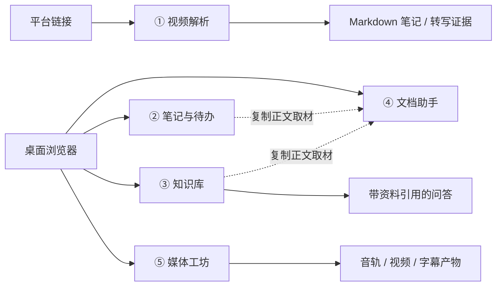

# 知记工作台 · 五个工具说明

> 更新时间：2026-10-27  
> 对应版本：v0.1.0 桌面 Web 工作台  
> 说明范围：当前已落地的实现，不把规划中的能力写成已完成能力。  
> “五个工具”指工作台内的五个工作区，不是五个独立服务。

## 1. 总览

知记工作台把“内容获取、个人整理、资料检索、写作加工、媒体处理”放在同一个桌面界面中。五个工具共享账号、数据库、任务系统、LLM 配置和本地文件目录，但各自只负责一段清晰的工作流。

| 工具 | 一句话定位 | 主要输入 | 主要输出 |
| --- | --- | --- | --- |
| ① 视频解析 | 把平台视频 / 图文整理成结构化 Markdown 笔记 | 抖音、B 站、知乎、小红书链接 | Markdown 笔记、原始转写证据 |
| ② 笔记与待办 | 管理日常笔记、标签和关联待办 | 用户手写内容 | `notes` / `todos` 数据 |
| ③ 知识库 | 把本地文本资料变成可检索、可问答的资料库 | TXT、Markdown、CSV、JSON、HTML | 切片索引、检索结果、带引用问答 |
| ④ 文档助手 | 在单篇长文里完成总结、问答、续写和润色 | 空白文档、笔记、知识库资料 | 可继续编辑和导出的文档 |
| ⑤ 媒体工坊 | 管理图片 / 音频 / 视频并做本机处理 | 本地上传的媒体文件 | 音轨、MP4、裁剪片段、SRT 字幕 |



当前有两个刻意保留的断点：

- 视频解析生成的 Markdown 文件尚未自动写入“笔记与待办”的 `notes` 表。
- 笔记尚未自动进入知识库；文档助手可以从笔记和知识库复制正文，但不会维持实时引用关系。

---

## 2. 共享技术架构

### 2.1 整体框架

知记采用**模块化单体**，不是微服务：

```text
桌面浏览器
  └─ Vue 3 工作台（Bento 首页 / Dot Dock / Focus Mode）
       └─ REST + SSE
            └─ FastAPI 单体
                 ├─ 工作区路由：视频 / 笔记 / 知识库 / 文档 / 媒体
                 ├─ SQLAlchemy 仓储层
                 ├─ 进程内 TaskWorker
                 ├─ OpenAI 兼容 LLM 客户端
                 ├─ 平台适配器与本地文件处理
                 └─ SQLite / PostgreSQL + 本地数据目录
```

这样做的原因是：第一版面向单机自托管，数据量、并发量和部署复杂度都有限。单体模块化可以减少运维组件，同时保留清晰的功能边界，后续若第二版需要 SaaS，再按真实瓶颈拆分。

### 2.2 前端框架

| 选型 | 当前用途 |
| --- | --- |
| **Vue 3.5** | 工作台、五个工作区和通用组件的 UI 框架；使用 `<script setup>` 单文件组件 |
| **Vite 5** | 开发服务器与生产构建 |
| **Pinia 2** | 登录状态、工作区切换、Toast、会话抽屉等共享 UI 状态 |
| **lucide-vue-next** | 统一线性图标 |
| **原生 JavaScript** | 当前前端不使用 TypeScript |
| **原生 `fetch` 封装** | REST 请求、JSON 响应和 `AbortController` 取消 |
| **原生 SSE 解析** | 在 `frontend/src/lib/api.js` 中解析 `text/event-stream`，不依赖第三方流式库 |

前端没有使用 Vue Router。工作区切换由 Pinia UI 状态和 `AppShell.vue` 完成；工作台外壳由 `BentoHome.vue`、`DotDock.vue`、Focus Mode 和统一会话抽屉组成。

### 2.3 后端框架

| 选型 | 当前用途 |
| --- | --- |
| **Python 3.11+** | 后端运行时；发布验收使用 Python 3.12 |
| **FastAPI** | HTTP API、SSE 流式响应和 `frontend/dist/` 静态资源托管 |
| **Uvicorn** | ASGI 应用服务器 |
| **Pydantic 2** | 请求体校验、字段长度限制和响应数据结构 |
| **SQLAlchemy 2.x** | 声明式 ORM、查询、事务与仓储层 |
| **Alembic** | 数据库迁移 |
| **SQLite / PostgreSQL** | SQLite 为默认单机库；需要时切换 PostgreSQL |
| **httpx** | 调用 OpenAI 兼容 LLM 和部分平台接口 |
| **进程内 TaskWorker** | 数据库即队列，默认 2 个后台线程执行长任务 |

### 2.4 数据与实时通信

- **REST**：普通 CRUD、列表查询、检索和文件下载。
- **SSE**：视频生成进度、知识库问答、文档 AI 协作等需要持续输出的场景。
- **轮询**：媒体任务主要查询 `GET /api/tasks/{id}`；视频任务另有 SSE 事件流。
- **任务持久化**：任务参数、状态、进度、结果和错误写入 `tasks` 表，服务重启后仍可恢复未完成任务。
- **用户隔离**：笔记、待办、知识库、文档、媒体和任务都通过 `user_id` 做作用域过滤，跨用户资源统一按不存在处理。

没有引入 Celery、Redis、RabbitMQ、LangChain、独立向量数据库或微服务框架。

### 2.5 共享数据表

| 数据表 | 归属 |
| --- | --- |
| `tasks` | 视频生成、媒体处理等长任务 |
| `notes` / `todos` | 笔记与待办 |
| `knowledge_libraries` / `knowledge_documents` / `knowledge_chunks` | 知识库、资料与切片索引 |
| `documents` | 文档助手 |
| `media_items` / `media_artifacts` | 媒体原件与处理产物 |
| `conversations` / `conversation_messages` | 视频解析后的会话与追问 |
| `model_configs` / `llm_credentials` / `platform_credentials` | 模型配置与加密凭据 |

---

## 3. ① 视频解析

### 3.1 解决什么问题

把平台上的知识视频、文章或图文内容抓取下来，转成可保存、可阅读、可继续追问的 Markdown 笔记。它解决的是“内容在平台里、笔记要另起工具加工”的第一段搬运问题。

当前支持：

- 抖音
- B 站
- 知乎
- 小红书

### 3.2 处理原理

```text
链接
  → 域名识别
  → 平台适配器解析内容 ID
  → 抓取元数据 / 正文 / 字幕 / 音视频信息
  → 字幕优先，缺失时本地转写
  → 长文本 map-reduce
  → LLM 流式生成 Markdown
  → 保存笔记与原始证据
```

具体流程：

1. `PlatformRegistry` 根据域名选择抖音、B 站、知乎或小红书适配器。
2. 适配器解析链接并抓取内容。不同平台按需要组合 `httpx`、`curl-cffi`、Playwright、登录 Cookie、平台接口或网页内容提取。
3. 优先使用平台已有字幕或正文；需要音频转写时，用 `yt-dlp` 下载音频，再用可选的 `faster-whisper` 在本机转写。
4. 视频如果转写失败，可以在有简介正文时降级使用简介，但会记录警告；没有可用文本时任务失败。
5. 文本超过 24,000 字符时启用 map-reduce：先按约 12,000 字符分块总结，再汇总生成最终笔记，避免直接超出模型上下文。
6. `LLMClient` 调用 OpenAI 兼容 `/chat/completions`，通过 SSE 把进度和正文增量推送到前端。
7. `MarkdownWriter` 保存最终 Markdown；`transcripts/` 保存可读转写，`artifacts/` 保存 `meta.json` 和 `transcript.json` 证据。
8. 生成完成后可在会话抽屉中继续追问。

### 3.3 技术栈与框架

| 层次 | 技术 | 用途 |
| --- | --- | --- |
| 前端 | Vue 3 `<script setup>` | 视频工作区交互与生成状态 |
| 前端 | Pinia | 当前任务、会话抽屉和 UI 状态 |
| 前端 | 原生 `fetch` + SSE | 创建任务、订阅进度、接收正文增量 |
| 后端 | FastAPI | 任务 API、SSE 响应和原业务路由 |
| 抓取 | `httpx` / `curl-cffi` / Playwright | 平台请求、浏览器态抓取和页面渲染 |
| 内容提取 | `html2text` 等 | 将网页内容转为可读文本 |
| 音频 | `yt-dlp` | 下载平台音频 |
| 转写 | `faster-whisper`（可选 `asr` 依赖） | 本地语音转文字 |
| 生成 | OpenAI 兼容 Chat Completions | 分块总结、笔记生成和追问 |
| 持久化 | SQLAlchemy `tasks` / `conversations` | 任务状态与会话记录 |
| 输出 | 本地 Markdown + JSON/TXT | 笔记、元数据和转写证据 |

### 3.4 当前边界

- 各平台抓取方式并不统一，平台风控、登录态或页面结构变化会影响成功率。
- 本地转写需要安装可选 `asr` 依赖；未安装时，没有现成字幕的视频无法完成转写。
- 当前是链接驱动，不做站内批量发现、批量抓取或学术全文批量下载。
- 生成的 Markdown 尚未自动导入笔记工作区，也尚未自动进入知识库。
- 视频工具的主要产出是“文件 + 会话”，不是普通笔记 CRUD 记录。

### 3.5 关键代码

- `frontend/src/workspaces/VideoWorkspace.vue`
- `src/zhiji/pipeline.py`
- `src/zhiji/platforms/registry.py`
- `src/zhiji/platforms/`
- `src/zhiji/transcription/engine.py`
- `src/zhiji/llm/prompts.py`
- `src/zhiji/writers/markdown.py`
- `src/zhiji/tasks.py`

---

## 4. ② 笔记与待办

### 4.1 解决什么问题

提供一个连续的“记录—整理—执行”空间：笔记承载内容和上下文，待办把下一步行动从笔记中拆出来，并允许两者建立关联。

### 4.2 处理原理

- 笔记和待办分别存储于 `notes`、`todos`，所有查询都带当前用户作用域。
- 笔记支持标题、正文、标签、置顶、搜索和更新时间。
- 待办支持标题、优先级、截止日期、完成状态和可选关联笔记。
- 前端采用“列表 / 编辑器 / 待办轨道”的三栏桌面布局。
- 编辑内容后 700ms 防抖自动保存；`Ctrl+S` 立即保存。
- 保存时使用编辑版本号和单一保存 Promise，避免连续输入时旧响应覆盖新内容。
- 删除采用两段式确认：第一次点击进入待确认状态，短时间内再次点击才真正删除。

```text
编辑器输入
  → 标记 dirty
  → 700ms 防抖
  → PUT /api/notes/{id}
  → 返回最新记录
  → 若无后续编辑，清除 dirty
```

待办通过 `note_id` 关联笔记。删除或查询关联对象时仍会校验用户作用域，不能借 ID 访问其他用户的数据。

### 4.3 技术栈与框架

| 层次 | 技术 | 用途 |
| --- | --- | --- |
| 前端 | Vue 3 `ref` / `reactive` / `computed` | 草稿状态、筛选、进度和编辑状态 |
| 前端 | Pinia | 工作区 UI 与 Toast |
| 后端 | FastAPI | `/api/notes` 与 `/api/todos` CRUD |
| 校验 | Pydantic 2 | 请求字段与更新载荷 |
| 数据 | SQLAlchemy 2.x | 仓储层的增删改查 |
| 存储 | SQLite / PostgreSQL | 笔记与待办持久化 |
| 交互 | 原生 DOM 事件和定时器 | 防抖保存、快捷键和选区处理 |

### 4.4 当前边界

- 只实现笔记、标签、置顶、搜索和关联待办。
- 提醒、日历、重复任务、习惯打卡尚未实现。
- 视频解析结果尚未自动生成笔记。
- 笔记不会自动同步到知识库或文档；文档取材是复制，不是实时引用。
- 当前交付目标是桌面浏览器，不把移动端适配作为验收项。

### 4.5 关键代码

- `frontend/src/workspaces/NotesWorkspace.vue`
- `src/zhiji/web/notes_api.py`
- `src/zhiji/storage/note_repository.py`
- `src/zhiji/storage/tables.py`

---

## 5. ③ 知识库

### 5.1 解决什么问题

把本地文本资料组织成资料库，支持导入、原文阅读、检索、命中片段引用和基于资料的问答。它要解决的是“文件只能按名字找，无法快速定位内容并追问”的问题。

当前支持：

- 资料库 CRUD
- 资料导入、重命名、删除和原文阅读
- TXT、Markdown、CSV、JSON、HTML
- 单文件最多 200 万字符
- 全文关键词 + 本地哈希向量混合检索
- 基于检索片段的 SSE 问答与编号引用

### 5.2 处理原理

```text
文本文件
  → 格式校验与正文提取
  → 文本规范化
  → 约 900 字切片（160 字重叠）
  → 中文双字 n-gram + 英文/数字词
  → 128 维 SHA-256 特征哈希向量
  → SQLite 保存原文、切片和向量
  → 混合打分排序
  → 取 Top-K 片段作为 LLM 上下文
  → 流式回答并标注引用编号
```

关键设计：

1. HTML 使用 Python 标准库 `HTMLParser` 提取正文，跳过 `script` 和 `style`。
2. 切片优先在段落、换行、中文句末和空格处断开，并记录原文起止偏移，便于回跳和高亮。
3. 中文按双字 n-gram 切分，英文和数字按词切分，不依赖外部分词服务。
4. “向量”是 SHA-256 特征哈希生成的 128 维确定性向量，不是神经网络 embedding。
5. 排序分数由四部分混合构成：
   - 关键词覆盖率：0.36
   - Jaccard 相似度：0.12
   - 余弦相似度：0.42
   - 连续短语命中：0.10
   - 短语命中额外加成：0.10
6. 没有匹配词且没有连续短语时直接淘汰，避免无依据召回。
7. 问答默认取 6 个片段（可调 1–12），先通过 SSE 返回来源元数据，再返回模型增量文本。
8. 系统提示要求模型只依据片段回答，并在句末标注 `[编号]`；资料不足时必须明确说明。

### 5.3 技术栈与框架

| 层次 | 技术 | 用途 |
| --- | --- | --- |
| 前端 | Vue 3 | 资料库、资料阅读、检索轨道和问答区 |
| 前端 | 原生 `fetch` + SSE | 检索请求、流式回答与停止生成 |
| 后端 | FastAPI | 资料库、资料、检索与问答 API |
| 提取 | Python 标准库 `HTMLParser` | HTML 正文提取 |
| 检索 | Python 正则 + Counter | 中文双字 n-gram、词项统计 |
| 向量 | SHA-256 特征哈希 | 128 维本地向量与余弦检索 |
| 排序 | 覆盖率 + Jaccard + 余弦 + 短语 | 混合相关性打分 |
| 持久化 | SQLAlchemy `knowledge_*` 表 | 资料库、资料、切片和向量 JSON |
| 生成 | OpenAI 兼容 Chat Completions | 基于资料的流式问答 |

### 5.4 当前边界

- PDF、DOC/DOCX、PPT/PPTX、XLS/XLSX 当前明确不支持，后续再接解析器。
- 没有接入外部 embedding 服务，也没有独立向量数据库；当前是本地轻量检索。
- 尚未自动导入知记生成的笔记或视频解析产物。
- 资料库按用户隔离，但不是团队共享库。
- 检索质量适合个人知识库规模；大规模语料需要后续评估更强索引。

### 5.5 关键代码

- `frontend/src/workspaces/KnowledgeWorkspace.vue`
- `src/zhiji/knowledge.py`
- `src/zhiji/web/knowledge_api.py`
- `src/zhiji/storage/knowledge_repository.py`
- `src/zhiji/storage/tables.py`

---

## 6. ④ 文档助手

### 6.1 解决什么问题

在单篇文档里完成从“起草”到“加工”的闭环：新建文档、从已有材料取材、边写边自动保存、调用 AI 总结 / 问答 / 续写 / 润色，并导出 Markdown 或纯文本。

### 6.2 处理原理

1. 文档保存于 `documents` 表，字段包括标题、正文、格式、来源类型和来源 ID。
2. 新建文档可以来自：
   - 空白文档
   - 笔记：复制笔记正文
   - 知识库资料：复制资料正文
3. 取材是正文复制，不建立实时引用；后续原笔记或资料变化不会自动回写文档。
4. 编辑内容后 700ms 自动保存，`Ctrl+S` 立即保存；每次更新带版本号，降低并发覆盖风险。
5. AI 协作请求直接携带浏览器中的最新草稿，因此不必等待自动保存完成。
6. 四种动作：
   - `summarize`：一句话结论、3–6 个要点和待确认问题。
   - `ask`：只依据当前文档回答，并区分文档事实与推断。
   - `continue`：顺着当前思路和语气续写 2–4 段。
   - `polish`：优先润色编辑器选区，否则处理整篇内容。
7. 后端将文档正文按 120,000 字符、润色目标按 80,000 字符裁剪后放入 Prompt；文档本身允许最多 1,000,000 字符。
8. 结果通过 SSE 流式返回，但不会自动覆盖正文。用户可选择：
   - 插入光标位置
   - 替换生成前选区
   - 替换全文
   - 复制结果
   - 重试
9. 如果生成期间正文已经变化，前端不会执行可能误伤的选区替换或全文替换。
10. 导出由后端生成附件，支持 Markdown 和纯文本，并使用 UTF-8 文件名。

### 6.3 技术栈与框架

| 层次 | 技术 | 用途 |
| --- | --- | --- |
| 前端 | Vue 3 | 文档列表、编辑器、选区跟踪和 AI 操作台 |
| 前端 | Pinia | 工作区状态、通知和共享 UI |
| 前端 | 原生 `fetch` + `AbortController` | SSE 协作、停止生成和防竞态 |
| 后端 | FastAPI `StreamingResponse` | SSE 流式 AI 响应 |
| 校验 | Pydantic 2 | 标题、正文、选区和动作约束 |
| 数据 | SQLAlchemy `documents` | 文档 CRUD 与来源元数据 |
| 导出 | FastAPI `Response` | Markdown / TXT 附件下载 |
| 生成 | OpenAI 兼容 LLM | 总结、问答、续写和润色 |

### 6.4 当前边界

- 当前是单文档协作，不是文档批处理系统。
- `doc_jobs` 异步任务尚未实现；单篇 AI 操作走请求内 SSE。
- 不提供复杂排版、PDF / Office 转换或多人协同编辑。
- 来源是复制关系，不是可追踪的双向链接。
- 长文 Prompt 会截断，不能假设超长文档的每个字都进入模型上下文。

### 6.5 关键代码

- `frontend/src/workspaces/DocsWorkspace.vue`
- `src/zhiji/web/docs_api.py`
- `src/zhiji/storage/doc_repository.py`
- `src/zhiji/storage/tables.py`

---

## 7. ⑤ 媒体工坊

### 7.1 解决什么问题

在本地管理图片、音频和视频，并完成常见的轻量媒体加工：预览、提取音轨、转 MP4、裁剪片段和生成字幕。它把原本需要多个桌面工具完成的零散操作收进工作台。

### 7.2 处理原理

```text
浏览器选择文件
  → raw body 流式上传
  → 写入临时文件并统计大小 / SHA-256
  → PyAV 探测媒体流、时长、尺寸和编码
  → 移入受控目录并写入 media_items
  → 提交 media.* 任务到 tasks 表
  → TaskWorker 异步处理
  → 产物写入 media_artifacts
  → 前端轮询进度、预览或下载
```

关键设计：

1. 上传使用 raw body，不走 multipart；文件名通过 query 参数传递。
2. 默认单文件上限 512 MiB，按块流式写入，避免整文件读入内存。
3. 文件名只用于展示，不直接作为磁盘路径；实际路径为 `data/media/<user-scope>/<media-id>/`。
4. 数据库只保存相对 `storage_path`、SHA-256、大小、时长、尺寸和编码信息。
5. 媒体处理复用 `tasks` 表，任务类型包括：
   - `media.extract_audio`
   - `media.transcode`
   - `media.trim`
   - `media.transcribe`
6. 探测、解码、编码均使用 **PyAV** 在进程内完成，不调用系统 FFmpeg 可执行文件。
7. 输出规则：
   - 音频：MP3，`libmp3lame`
   - 视频：MP4，H.264 / `libx264` + AAC，`yuv420p`，CRF 23，`veryfast`
   - 裁剪：使用毫秒区间
   - 字幕：可选 `faster-whisper` 生成 SRT
8. 同一素材同时只允许一个活动处理任务；任务支持进度、取消、失败记录和产物管理。
9. 素材和产物都按用户作用域读取，产物可在线预览、下载和两段式删除。

### 7.3 技术栈与框架

| 层次 | 技术 | 用途 |
| --- | --- | --- |
| 前端 | Vue 3 | 媒体库、预览区、处理轨道和产物轨道 |
| 前端 | XMLHttpRequest + `fetch` | XMLHttpRequest 提供上传进度，fetch 负责操作、查询与轮询任务 |
| 后端 | FastAPI | 上传、预览、下载、任务和产物 API |
| 媒体引擎 | **PyAV** | 容器探测、解码、抽音轨、转码、裁剪 |
| 转写 | `faster-whisper`（可选） | 音频 / 视频字幕 |
| 异步 | 进程内 `TaskWorker` | 长任务执行、进度、取消与恢复 |
| 数据 | SQLAlchemy | `tasks`、`media_items`、`media_artifacts` |
| 文件 | 本地具名文件卷 | 媒体原件和产物持久化 |

### 7.4 当前边界

- 当前只做单文件处理，不做批量转码队列。
- 不提供复杂滤镜、多轨合成、时间线编辑或专业剪辑能力。
- 字幕依赖可选 `faster-whisper`；未安装时其它媒体功能仍可用。
- 没有对象存储、云端转码或云端导出。
- 处理能力受本机 CPU / 内存和磁盘空间限制。

### 7.5 关键代码

- `frontend/src/workspaces/MediaWorkspace.vue`
- `src/zhiji/media_service.py`
- `src/zhiji/web/media_api.py`
- `src/zhiji/storage/media_repository.py`
- `src/zhiji/transcription/engine.py`
- `src/zhiji/tasks.py`

---

## 8. 工具之间如何衔接

| 当前链路 | 状态 | 说明 |
| --- | --- | --- |
| 视频解析 → Markdown 文件 | ✅ 已实现 | 生成笔记和转写证据保存在输出目录 |
| 视频解析 → 笔记与待办 | ❌ 未实现 | 尚未自动写入 `notes` 表 |
| 笔记 → 文档助手 | ✅ 已实现 | 新建文档时复制笔记正文 |
| 知识库 → 文档助手 | ✅ 已实现 | 新建文档时复制资料正文 |
| 笔记 / 视频产物 → 知识库 | ❌ 未实现 | 尚未自动导入索引 |
| 知识库 → 引用问答 | ✅ 已实现 | 检索片段作为上下文，回答带编号引用 |
| 媒体 → 视频解析 | ❌ 未实现 | 视频解析当前以平台链接为主要输入 |
| 媒体 → 知识库 | ❌ 未实现 | 字幕尚未自动作为资料导入知识库 |

这些断点不是遗漏的 UI 按钮，而是当前 MVP 的明确边界。后续若要打通，应先定义跨工作区的数据契约和幂等策略，而不是在页面之间直接复制状态。

---

## 9. 共同的设计取舍

### 9.1 为什么用模块化单体

第一版的目标是单机自托管、桌面 Web、个人或少量账号使用。单体可以减少部署组件和故障面，仓储层、路由层和任务处理器仍保持模块边界，足以支撑当前规模。

### 9.2 为什么任务队列放在数据库里

`tasks` 表同时承担队列、状态和结果存储。提交任务后可以关闭页面，重新打开时按任务 ID 查询；服务重启后也能恢复未完成任务。代价是吞吐量有限，不适合大规模分布式并发，但这符合第一版定位。

### 9.3 为什么知识库不接向量数据库

当前资料来源规模以个人知识库为主，本地 n-gram + 特征哈希 + 关键词混合检索已经能提供可解释结果，并且不需要额外服务、密钥和索引运维。它不是“真语义向量检索”，文档和界面都应保持这个技术事实。

### 9.4 为什么媒体处理用 PyAV

PyAV 随 Python 依赖安装，可以直接在进程内探测、解码和编码，不需要用户额外安装系统 FFmpeg。它适合当前单文件闭环；更复杂的滤镜、硬件加速和多轨能力应作为独立能力重新评估。

### 9.5 为什么 AI 输出不直接覆盖内容

文档助手把生成结果放在协作操作台，由用户选择插入、替换或复制。这样既保留人工确认权，也避免模型输出直接破坏原稿。知识库问答则明确区分“资料事实”和“模型推断”。

---

## 10. 当前状态与后续

| 工具 | 当前状态 | 下一步优先项 |
| --- | --- | --- |
| ① 视频解析 | 主链路可用 | 视频结果导入笔记、失败重试与更稳定的平台适配 |
| ② 笔记与待办 | MVP 可用 | 提醒、日历、习惯打卡、视频结果导入 |
| ③ 知识库 | MVP 可用 | PDF / Office 解析、笔记自动入库、更大规模检索评估 |
| ④ 文档助手 | MVP 可用 | 批处理、复杂格式转换、异步 `doc_jobs` |
| ⑤ 媒体工坊 | MVP 可用 | 批量处理、更多编解码选项、复杂滤镜 |

发布验收、部署方式和数据接口分别见：

- [发布验收](RELEASE_ACCEPTANCE.md)
- [部署指南](DEPLOY.md)
- [数据 / API 现状](WORKBENCH_DATA_API.md)
- [技术基线](WORKBENCH_TECH.md)

